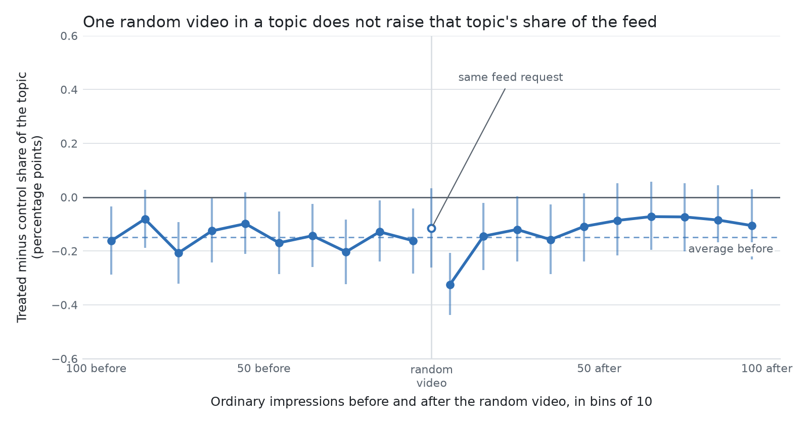

# Can one random video bend your feed?

I used a real experiment inside the Kuaishou app to test whether a single chance
encounter with a topic changes what the recommender shows you next.

<!-- MYO: write 2–4 sentences on why you cared -->

## What I found

It does not. After one random video in a topic, that topic's share of the next 30
recommendations changed by -0.04 percentage points, with a 95% interval from -0.10
to +0.02. The only movement is a small dip in the first 10 recommendations. In the main
estimate it is gone by the next 30. In the three pre-registered checks it is still
just visible at 30 (-0.07 to -0.11 points), always well inside the half-point rule
I set in advance.



The line sits below zero even before the random video. That is a quirk of how the
random videos were drawn, explained below. What matters is whether the line moves at
the random video. It dips once and comes back.

## The two explanations

**The feed bends.** One exposure, especially if watched, shifts what the recommender
serves next.

**Noise.** One exposure is too small a signal, so the difference is close to zero.

Noise held. I wrote the rule before computing anything: call it noise if the
intervals for all three windows sit inside half a percentage point of zero. They do.
The average topic here has about 5.47% of the feed, so half a point would have been a
visible change. I think this is the more useful answer of the two. A feed that
swerved after every accidental view would be unstable, and this one does not.

## How I tested it

The data is KuaiRand-1K (Gao et al., CIKM 2022): 1,000 Kuaishou users, 11,713,045
ordinary recommendations and 43,028 random ones. For about two weeks the app swapped
a random video into the feed now and then, and the log marks which ones.

Chance picked the topic of each random video. So for each of 13 topics, I compare
users who happened to get a random video in that topic (treated) with users who got
one in any other topic (control). The outcome is the topic's share of the next 10, 30
and 100 ordinary recommendations, minus its share of the 100 before. Intervals come
from 2,000 bootstrap resamples of whole users, because one user contributes many
random videos.

I committed [`PREREGISTRATION.md`](PREREGISTRATION.md) before any code that computes
an outcome, and the git history shows that order.

| Window after the random video | Change in the topic's share, treated minus control | 95% interval |
|---|---:|---|
| Next 10 recommendations | -0.17 points | -0.25 to -0.09 |
| Next 30 | -0.04 points | -0.10 to +0.02 |
| Next 100 | +0.03 points | -0.02 to +0.08 |

Users who left after the random video stay in the analysis. Leaving was equally
common in both groups: 5.60% of treated and 5.61% of control exposures had no further
recommendation within 30 minutes.

Everything else is in [`results/event_study.md`](results/event_study.md): each topic
on its own, the three pre-registered checks, and the numbers behind the figure. The
balance table is in [`results/balance.md`](results/balance.md). My reading of earlier
work is in [`docs/related_work.md`](docs/related_work.md).

## Watched and skipped

The average hides two groups. Only 17.4% of random videos were watched. After a
watched one, the topic's share of the next 30 recommendations went up by +0.33
points. After a skipped one it went down by -0.12.

I would like to say the feed listens to both signals. I cannot, because nobody
randomised who watched. People watch what they already like: users who watched the
random video were already seeing 1.27 points more of its topic than controls before it
appeared. So this section is a description. It tells me where to look next, and it
does not prove a cause. Details are in
[`results/heterogeneity.md`](results/heterogeneity.md).

New users, long-standing users, heavy users and light users all gave the same answer
as the whole sample.

## What surprised me

**The dip.** I expected either a rise or nothing. The first 10 recommendations after
the random video contain slightly less of its topic (-0.17 points). Film and TV shows
it most, at -0.60. My guess is that the feed avoids repeating a topic it has just
shown, since most random videos were skipped. It is a guess. I can see what the feed
showed and I cannot see why.

**The random draw was not fully random.** Treated users started with slightly less of
the topic than controls: 5.30% against 5.45% of their last 100 recommendations. That
should not happen if chance alone picked the video. I found the reason in the logs.
The app almost never gave a user the same random video twice (2 times, where a draw
that ignored history would give about 353). So the draw skipped videos the user had
already been shown, and fans of a topic have seen more of them. This is why the
figure starts below zero, and why I subtract each user's own "before" level. I would
have missed it without the balance table, and I now think a balance table should
come before any result in work like this.

## What did not work

My first idea of "the next 10 recommendations" was wrong. I assumed each row in the
log had its own time. It does not. About six videos share one timestamp because the
app fetches them together. Videos in the same batch as the random one were chosen
before the user saw it, so I had to leave them out and start counting at the next
batch.

The data cannot tell me about truly new users. The dataset only keeps people who got
at least 10 random videos, so everyone in it is fairly active.

## What I would do next

- Repeat this on the full dataset of 27,285 users, to see whether the small rise after
  a watched video is real.
- Ask about the second and third random video in the same topic. One video does not
  bend the feed. I want to know how many do.

## Run it

```
pip install -r requirements.txt
python scripts/download.py        # about 4.8 GB of downloads from Zenodo
python scripts/sanity.py          # matches the paper's six counts for this dataset
python scripts/design_facts.py
python scripts/balance.py
python scripts/draw_check.py
python scripts/event_study.py
python scripts/heterogeneity.py
python scripts/check_readme.py    # traces every number above to a file in results/
pytest
```

Process notes are in [`CHANGELOG.md`](CHANGELOG.md). Changes from the pre-registration
are in [`DEVIATIONS.md`](DEVIATIONS.md). Data: KuaiRand, https://kuairand.com. No data
is stored in this repo.
