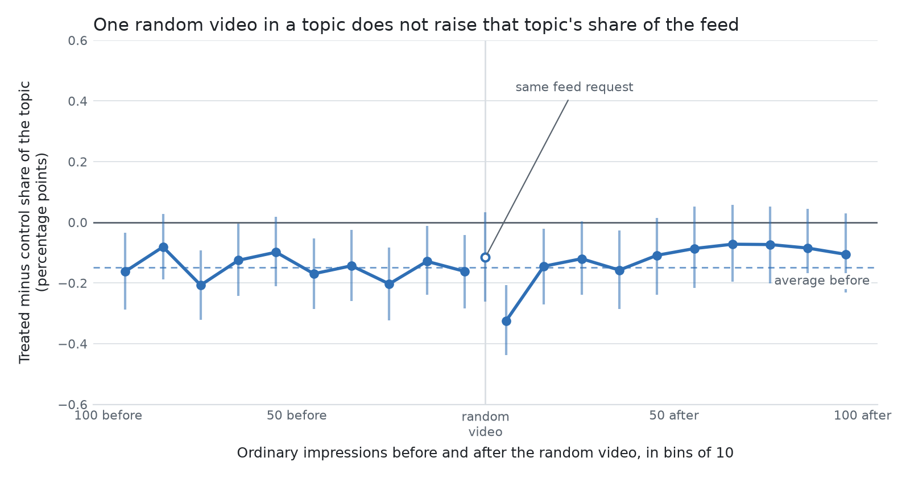

# Event study: the feed after one random video

Generated by `scripts/event_study.py`. Effects are in percentage points of feed share,
pooled over the 13 target topics. Intervals come from 2,000 bootstrap resamples of users.

## Main result (pre-registered)

Change is the topic's share in the window minus its share in the 100 impressions before.

| Window | Treated exposures | Treated change | Control change | Effect | 95% interval | 98.33% interval |
|---|---:|---:|---:|---:|---|---|
| Next 10 | 31,868 | -0.09 | +0.08 | -0.17 | -0.25 to -0.09 | -0.27 to -0.07 |
| Next 30 | 31,868 | -0.02 | +0.02 | -0.04 | -0.10 to +0.02 | -0.11 to +0.03 |
| Next 100 | 31,868 | +0.01 | -0.02 | +0.03 | -0.02 to +0.08 | -0.03 to +0.09 |

Decision by the pre-registered rule (98.33% intervals, margin ±0.5 points): **noise**.

The pre-registration also says an interval entirely below zero is reported as its own
finding. That holds for the next 10 impressions: the feed shows slightly less of the topic there.

Exposures used: 42,952 of 43,028. 2 have no impression before and 74 have none after.

## Plain difference, no baseline subtracted

| Window | Treated share | Control share | Difference | 95% interval |
|---|---:|---:|---:|---|
| Next 10 | 5.20% | 5.53% | -0.32 | -0.44 to -0.21 |
| Next 30 | 5.27% | 5.47% | -0.20 | -0.30 to -0.09 |
| Next 100 | 5.30% | 5.43% | -0.13 | -0.23 to -0.02 |

## Event study in bins of 10 impressions

Plain shares, treated minus control. Bins before the exposure are a placebo. They sit
at -0.15 on average, the same tilt the balance table shows. The dashed line marks it.

| Impressions | Treated share | Control share | Difference | 95% interval |
|---|---:|---:|---:|---|
| -100 to -91 | 5.26% | 5.43% | -0.16 | -0.29 to -0.03 |
| -90 to -81 | 5.33% | 5.41% | -0.08 | -0.19 to +0.03 |
| -80 to -71 | 5.23% | 5.43% | -0.21 | -0.32 to -0.09 |
| -70 to -61 | 5.31% | 5.44% | -0.13 | -0.24 to -0.00 |
| -60 to -51 | 5.33% | 5.43% | -0.10 | -0.21 to +0.02 |
| -50 to -41 | 5.27% | 5.44% | -0.17 | -0.29 to -0.05 |
| -40 to -31 | 5.30% | 5.45% | -0.14 | -0.26 to -0.02 |
| -30 to -21 | 5.28% | 5.48% | -0.20 | -0.32 to -0.08 |
| -20 to -11 | 5.34% | 5.47% | -0.13 | -0.24 to -0.01 |
| -10 to -1 | 5.30% | 5.47% | -0.16 | -0.28 to -0.04 |
| same request | 5.38% | 5.50% | -0.12 | -0.26 to +0.03 |
| +1 to +10 | 5.20% | 5.53% | -0.32 | -0.44 to -0.21 |
| +11 to +20 | 5.31% | 5.45% | -0.14 | -0.27 to -0.02 |
| +21 to +30 | 5.31% | 5.43% | -0.12 | -0.24 to +0.00 |
| +31 to +40 | 5.26% | 5.42% | -0.16 | -0.29 to -0.03 |
| +41 to +50 | 5.32% | 5.42% | -0.11 | -0.24 to +0.01 |
| +51 to +60 | 5.32% | 5.41% | -0.09 | -0.22 to +0.05 |
| +61 to +70 | 5.34% | 5.41% | -0.07 | -0.20 to +0.06 |
| +71 to +80 | 5.34% | 5.41% | -0.07 | -0.20 to +0.05 |
| +81 to +90 | 5.31% | 5.40% | -0.09 | -0.21 to +0.04 |
| +91 to +100 | 5.28% | 5.39% | -0.11 | -0.23 to +0.03 |

## Dropout

| Measure | Treated | Control | Difference | 95% interval |
|---|---:|---:|---:|---|
| No later impression within 30 minutes | 5.60% | 5.61% | -0.01 | -0.14 to +0.11 |
| No later impression before the log ends | 0.18% | 0.17% | +0.01 | -0.02 to +0.03 |

## Checks (pre-registered)

Same estimator as the main result, with one thing changed.

| Check | Window | Treated exposures | Effect | 95% interval |
|---|---|---:|---:|---|
| Only impressions within 60 minutes | Next 10 | 30,609 | -0.21 | -0.31 to -0.12 |
| Only impressions within 60 minutes | Next 30 | 30,609 | -0.11 | -0.19 to -0.03 |
| Only impressions within 60 minutes | Next 100 | 30,609 | -0.08 | -0.16 to -0.01 |
| Feed limited to tab 1 | Next 10 | 31,616 | -0.21 | -0.29 to -0.13 |
| Feed limited to tab 1 | Next 30 | 31,616 | -0.07 | -0.13 to -0.02 |
| Feed limited to tab 1 | Next 100 | 31,616 | +0.01 | -0.04 to +0.06 |
| Topics from the tag column | Next 10 | 33,231 | -0.22 | -0.31 to -0.12 |
| Topics from the tag column | Next 30 | 33,231 | -0.09 | -0.15 to -0.02 |
| Topics from the tag column | Next 100 | 33,231 | -0.01 | -0.06 to +0.04 |

## By topic (exploratory, no correction for 13 topics)

| Topic | Treated | Next 10 | 95% interval | Next 30 | 95% interval | Next 100 | 95% interval |
|---|---:|---:|---|---:|---|---:|---|
| Film and TV | 6,387 | -0.60 | -0.87 to -0.32 | -0.21 | -0.40 to -0.01 | -0.01 | -0.18 to +0.18 |
| Games | 4,410 | -0.08 | -0.30 to +0.15 | +0.07 | -0.08 to +0.22 | +0.11 | -0.01 to +0.25 |
| Anime and comics | 4,347 | +0.00 | -0.17 to +0.18 | -0.02 | -0.14 to +0.11 | -0.03 | -0.14 to +0.07 |
| Food | 2,990 | +0.05 | -0.23 to +0.31 | +0.17 | -0.03 to +0.38 | +0.23 | +0.05 to +0.41 |
| Comedy | 1,999 | -0.30 | -0.61 to +0.02 | -0.05 | -0.26 to +0.16 | -0.06 | -0.22 to +0.09 |
| Sports | 1,950 | -0.08 | -0.31 to +0.16 | -0.06 | -0.22 to +0.11 | +0.01 | -0.14 to +0.15 |
| Short drama | 1,763 | -0.17 | -0.46 to +0.13 | -0.05 | -0.23 to +0.13 | +0.01 | -0.13 to +0.16 |
| Music | 1,734 | +0.00 | -0.33 to +0.36 | +0.03 | -0.22 to +0.27 | +0.00 | -0.17 to +0.19 |
| Dance | 1,442 | -0.10 | -0.37 to +0.17 | -0.06 | -0.24 to +0.13 | +0.03 | -0.13 to +0.18 |
| Celebrities | 1,345 | -0.08 | -0.44 to +0.25 | -0.10 | -0.33 to +0.11 | -0.03 | -0.21 to +0.14 |
| Art | 1,318 | -0.10 | -0.36 to +0.19 | -0.14 | -0.33 to +0.09 | +0.03 | -0.13 to +0.22 |
| Pets | 1,107 | +0.02 | -0.18 to +0.24 | +0.03 | -0.10 to +0.17 | -0.01 | -0.11 to +0.10 |
| Beauty | 1,076 | +0.02 | -0.26 to +0.31 | -0.07 | -0.27 to +0.12 | -0.06 | -0.20 to +0.08 |
