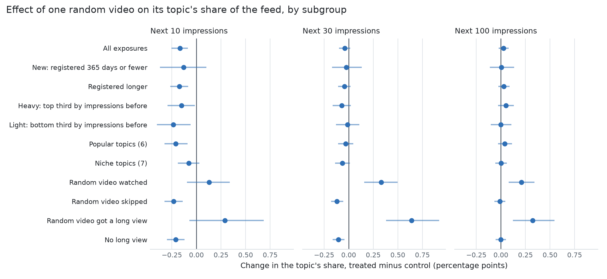
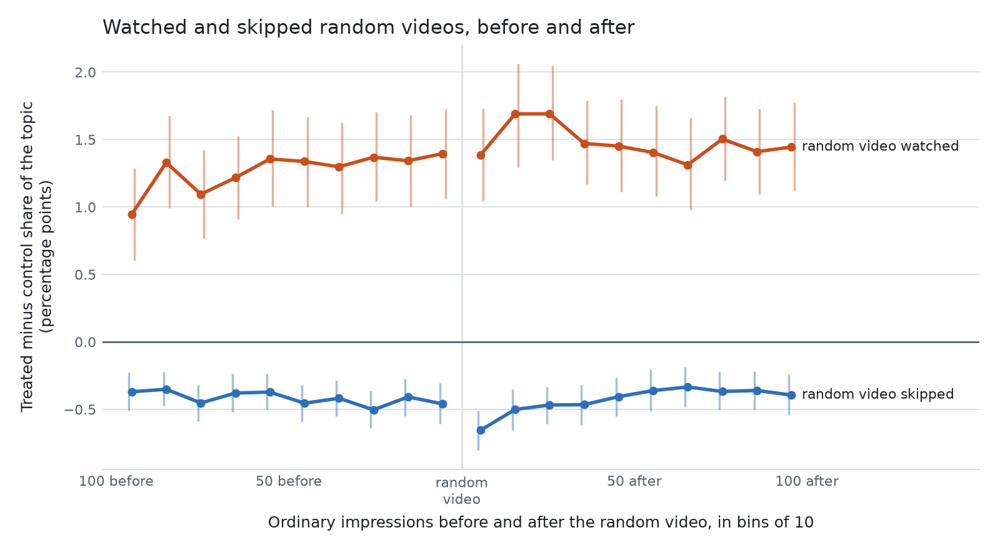

# Heterogeneity (exploratory)

Generated by `scripts/heterogeneity.py`. Same estimator as the main result inside each
subgroup: change in the topic's share, treated minus control, in percentage points,
with 95% intervals from a bootstrap over users. Nothing here is corrected for the
number of subgroups, so single intervals that miss zero are not findings.

| Split | Group | Users | Treated exposures | Next 10 | 95% interval | Next 30 | 95% interval | Next 100 | 95% interval |
|---|---|---:|---:|---:|---|---:|---|---:|---|
| All | All exposures | 1,000 | 31,868 | -0.17 | -0.25 to -0.09 | -0.04 | -0.10 to +0.02 | +0.03 | -0.02 to +0.08 |
| Users | New: registered 365 days or fewer | 144 | 4,472 | -0.13 | -0.37 to +0.10 | -0.02 | -0.17 to +0.13 | +0.01 | -0.11 to +0.14 |
| Users | Registered longer | 856 | 27,396 | -0.17 | -0.27 to -0.08 | -0.04 | -0.11 to +0.02 | +0.03 | -0.02 to +0.09 |
| Users | Heavy: top third by impressions before | 334 | 13,432 | -0.15 | -0.29 to -0.02 | -0.07 | -0.16 to +0.02 | +0.05 | -0.03 to +0.13 |
| Users | Light: bottom third by impressions before | 334 | 7,673 | -0.23 | -0.40 to -0.06 | -0.01 | -0.13 to +0.11 | -0.00 | -0.10 to +0.11 |
| Topics | Popular topics (6) | 1,000 | 21,867 | -0.21 | -0.32 to -0.09 | -0.03 | -0.11 to +0.05 | +0.04 | -0.03 to +0.11 |
| Topics | Niche topics (7) | 1,000 | 10,001 | -0.08 | -0.19 to +0.03 | -0.06 | -0.14 to +0.01 | +0.00 | -0.06 to +0.06 |
| Watching (descriptive) | Random video watched | 849 | 5,588 | +0.13 | -0.10 to +0.34 | +0.33 | +0.16 to +0.50 | +0.21 | +0.08 to +0.34 |
| Watching (descriptive) | Random video skipped | 1,000 | 26,280 | -0.23 | -0.32 to -0.14 | -0.12 | -0.18 to -0.05 | -0.01 | -0.07 to +0.05 |
| Watching (descriptive) | Random video got a long view | 699 | 2,677 | +0.29 | -0.07 to +0.68 | +0.64 | +0.38 to +0.92 | +0.32 | +0.12 to +0.54 |
| Watching (descriptive) | No long view | 1,000 | 29,191 | -0.21 | -0.30 to -0.12 | -0.10 | -0.16 to -0.04 | -0.00 | -0.05 to +0.05 |

Random videos were watched (a valid play) 17.4% of the time and got a long view 8.4% of the time.

Watching is the user's choice. A user who watches a random video in a topic probably
likes that topic already. The watched and skipped rows compare treated and control
exposures with the same watching status, and they describe what followed. They do not
show what watching causes.

## Watched against skipped, before and after (not pre-registered)

Plain treated-minus-control share of the topic in bins of 10 impressions, as in the
main event study, split by whether the random video was watched. The level before the
exposure shows how much the two groups differed already. See `DEVIATIONS.md`.

| Random video | Average of the 10 bins before | Last bin before | Average of the 3 bins after | After minus before |
|---|---:|---:|---:|---:|
| Watched | +1.27 | +1.40 | +1.59 | +0.32 |
| Skipped | -0.42 | -0.46 | -0.54 | -0.12 |
